[中文](README.md) | [English](README.en.md)

# PrintDesk · 印刷与广告制作订单经营系统 · Java / Spring Boot / Vue / MySQL


**知华科技（上海如静知华信息科技有限公司）** · [官网](https://www.zhuatech.cn/)

把一笔定制制作订单从报价、客户确认稿件，到领料、制作、委外、质检、交货和收款连在一起。适合有销售、设计、制作与独立质检分工的中小数码印刷、喷绘标识及定制制作团队，以及为其部署和定制业务系统的软件实施团队。

**1.0.0 · 公开源码学习版／非商业源码版。** 仅限个人学习、技术研究与非商业交流；未经书面授权不得商用。源码公开不等于允许免费商用或OSI开源许可，自有代码以[LICENSE](LICENSE)为准，第三方组件保留各自许可。

## 一笔订单怎样完成

报价草稿 → 发布报价版本 → 客户本人确认 → 客户批准最新稿件 → 派工开工 → 领退料与实际报工 → 委外收回 → 独立质检／返工 → 分批交货 → 外部收退款登记 → 结清。

客户与员工使用各自账号。客户只看绑定客户的已发布订单、准确稿件和交货记录；员工按组织或本人派工查看。销售不能代替客户确认，制作人员不能为自己做质检。新稿件与新报价须重新确认，旧版本保留；记录确切确认账号和时间。

## 已实现模块

| 模块 | 可实际执行的业务 |
|---|---|
| 客户端 | 独立登录、本人报价确认/修改要求、准确稿件批准/退回、原始资料上传、授权文件下载、交货进度 |
| 报价 | 最多20行、材料成本快照、按件耗材/平方米外包络、制作/后道/开机费、成本加成、折扣和手工税率、发布版本快照 |
| 文件与审稿 | PDF/PNG/JPEG实际上传、5MB上限、文件签名、SHA-256、原始资料/待审稿件区分、不可变旧版本、最新版本开工门槛 |
| 材料 | 张/平方米/件、币种、真实入库、凭据去重、移动平均成本、订单领料、引用原领料退回、已消耗材料保护 |
| 制作 | 同组织派工、本人开工与报工、良品/报废/分钟/约定小时成本、足量耗材、独立质检和返工成本保留 |
| 委外 | 供应商目录、加工任务、外部确认凭据、分批收回、比例成本、取消及质检完成门槛 |
| 交货与钱款 | 自提/送货/发运、逐行分批交货、超量拒绝、外部收款/原款退款、超收/超退拒绝、交完且净收齐才结清 |
| 工作台 | 搜索、状态过滤、排序、分页、订单详情、当前页面打印、CSV商业摘要、防公式导出、按币种真实统计 |
| 后台 | 账号启停/改密/重置、6初始角色、自定义权限、ALL/组织/本人/绑定客户范围、组织、菜单、分类、参数、审计 |
| 维护 | CSRF会话、实时权限、版本冲突、订单请求幂等、数据库迁移、私有备份及全新独立恢复、中文/English响应式页面 |

客户与制作角色的未授权成本、付款或内部信息在后端剔除，不能仅靠前端隐藏。上传与下载都校验订单归属；密码散列、文件二进制和幂等指纹不作为业务JSON输出。

## 实际运行页面

以下截图来自当前系统运行的TEST合成验收记录，不代表真实客户或付费案例；全新安装不加载这些业务记录、客户或测试账号。

| 页面 | 实际功能 |
|---|---|
| 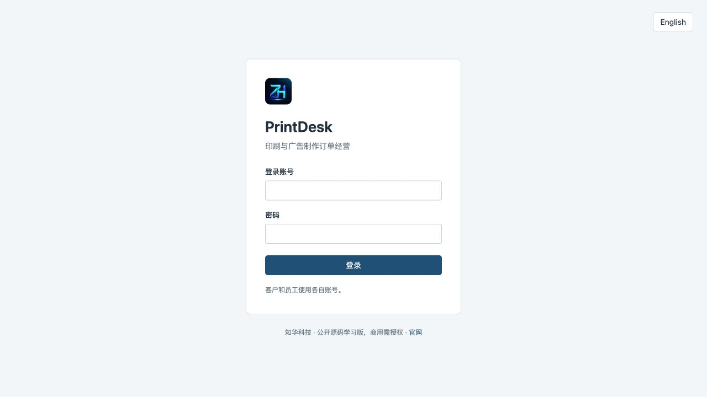 | 登录与中英文入口 |
| 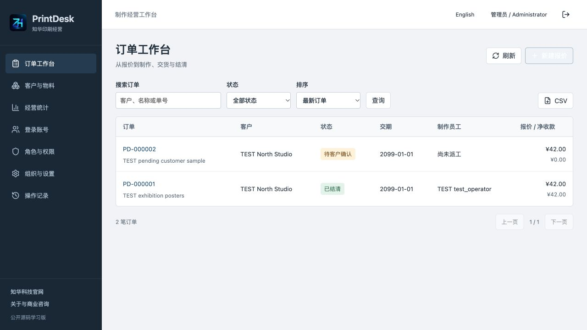 | 搜索、状态与订单明细 |
| 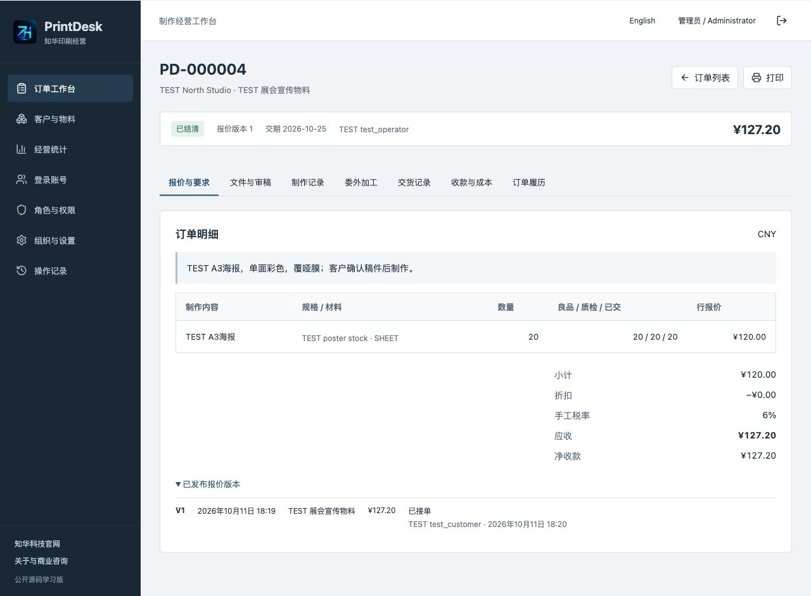 | 报价版本、制作规格与数量 |
| 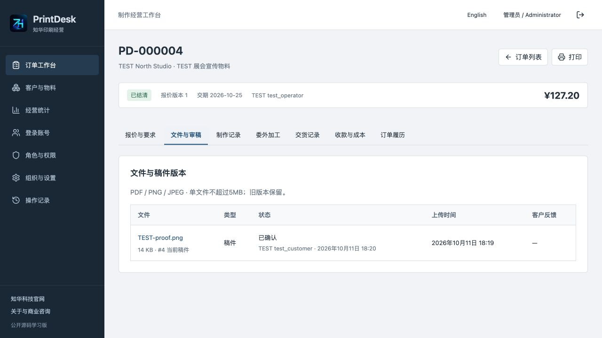 | 实际文件版本与客户确认状态 |
| 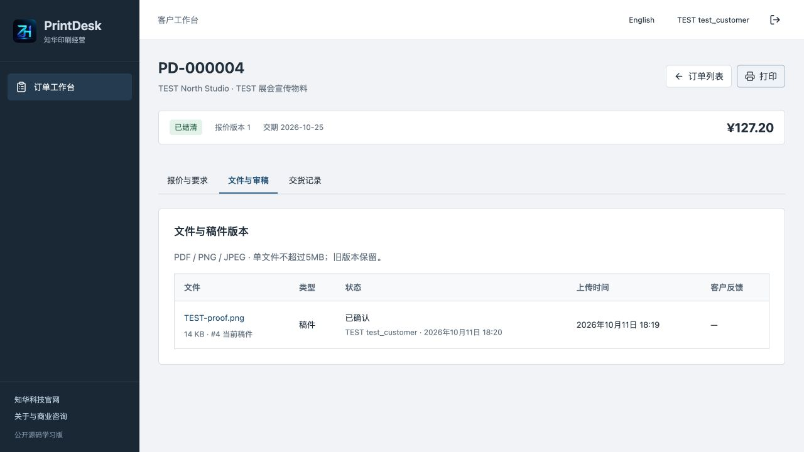 | 本人报价和当前稿件确认 |
| 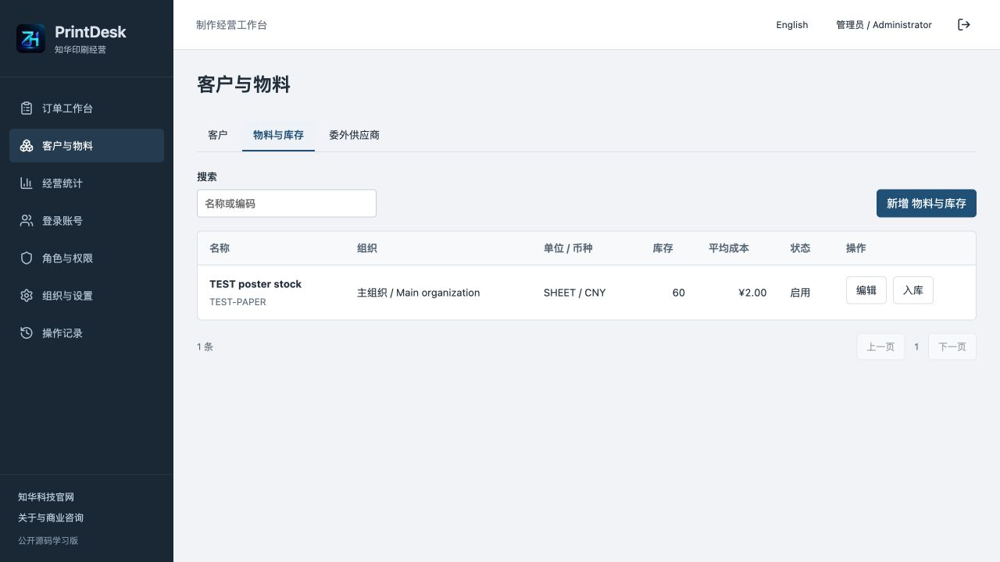 | 真实入库与库存成本 |
| 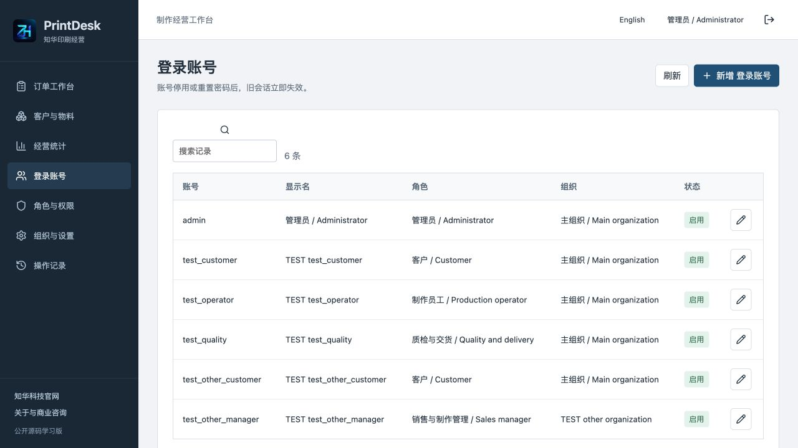 | 后台登录账号与角色 |
| 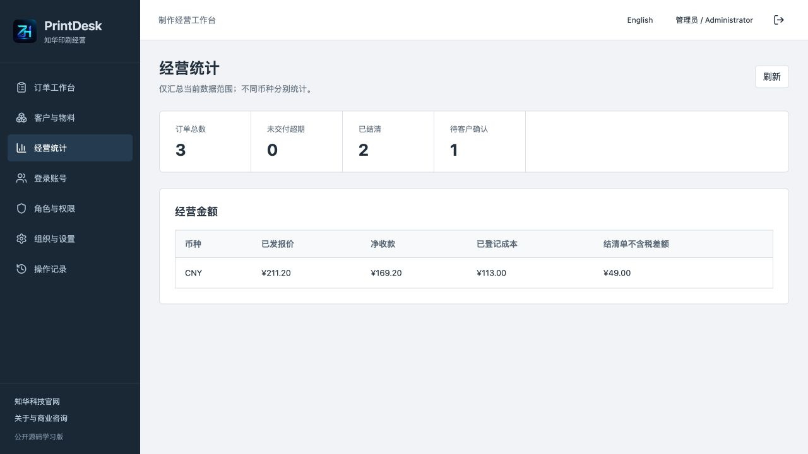 | 实际订单、收款、成本与币种统计 |
| 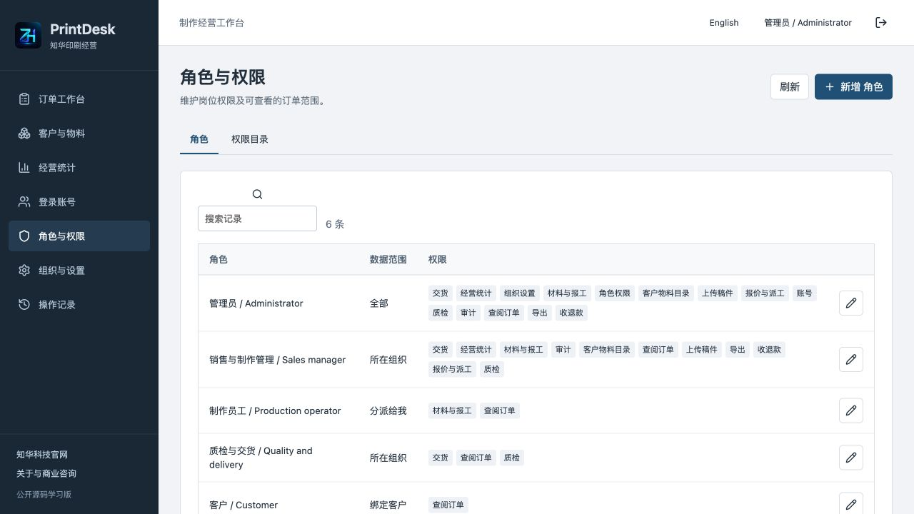 | 自定义角色和数据范围 |
| 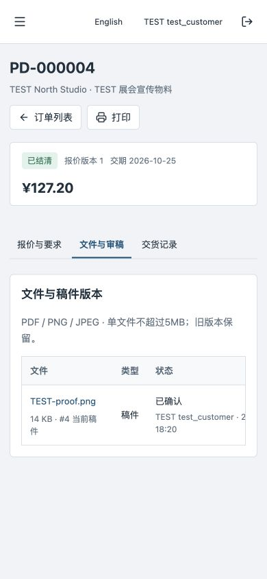 | 响应式客户页面 |
| 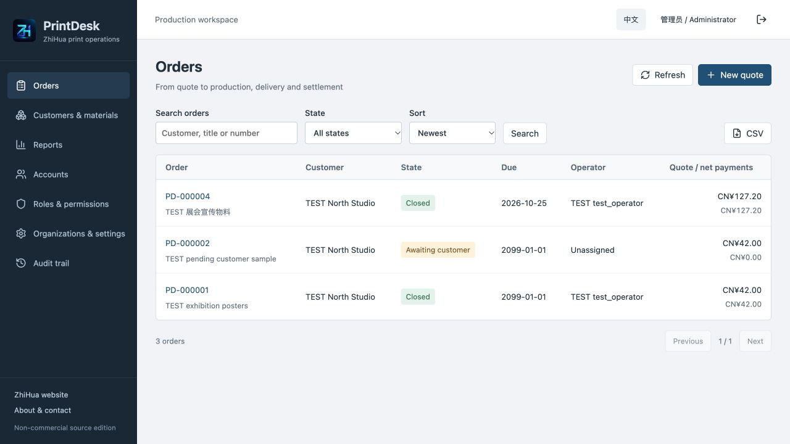 | 英文工作台 |

## 技术、数据库与目录

Java21、Spring Boot4.0.7、Security、JPA/Hibernate、Flyway；Vue3.5.43、Vite8.1.5、Node24.19.0、Lucide；MySQL8.4、Nginx与Docker Compose。浏览器通过同源Nginx访问/api；会话Cookie为HttpOnly/SameSite Strict，写入有CSRF。BCrypt12轮；账号/组织停用或改密使旧会话失效，权限实时查询。

```text
backend/src/main/java/cn/zhuatech/printdesk/   业务、权限与身份服务
backend/src/main/resources/db/migration/     V1身份、V2印刷经营、V3确认与收回凭据
backend/src/test/java/                       报价与HTTP/安全/JPA验证
frontend/src/components/                     报价、业务登记、目录及后台
frontend/public/brand/                       正式LOGO与原始联系素材
docs/                                       操作、接口、部署、测试、真实截图
scripts/                                    环境、验收、备份与恢复
compose.yaml / compose.dev.yaml             完整部署 / 本机开发数据库
```

23张应用表及Flyway历史表，首次初始化一个组织、一个管理员、6角色、14权限、7菜单、3订单分类、2参数，无业务示例。Flyway顺序执行V1__identity.sql、V2__print_business.sql、V3__review_and_receipts.sql，Hibernate只validate。新增升级使用新版本迁移，不修改已执行校验和；升级前备份。所有业务和二进制文件存在mysql-data卷。

## 安装与配置

完整Compose需Docker Engine/Desktop、Compose V2、Python3.10+，建议至少4GB可用内存。源码开发另需JDK21、Maven3.9+、Node24.19.0+和npm。构建需访问官方依赖源，基础流程无需付费外部账号。

```sh
python3 scripts/init-env.py
docker compose -p printdesk config --quiet
docker compose -p printdesk up -d --build --wait --wait-timeout 240
```

员工和客户登录：[http://127.0.0.1:8143/](http://127.0.0.1:8143/)；健康：[http://127.0.0.1:8143/actuator/health](http://127.0.0.1:8143/actuator/health)。首次账号admin，密码读取本机私有.env的ADMIN_PASSWORD；脚本随机生成，拒绝覆盖，没有共享演示口令。环境变量更改不重置已有账号。

| 配置 | 用途 |
|---|---|
| MYSQL_ROOT_PASSWORD / DATABASE_PASSWORD | 必填独立强密码 |
| ADMIN_USERNAME / ADMIN_PASSWORD | 首次空库管理员；密码12–72字节含大小写与数字 |
| WEB_PORT / BIND_ADDRESS | 默认8143 / 127.0.0.1，私有覆盖避免冲突 |
| COOKIE_SECURE | 本机HTTP false；HTTPS部署true |
| DATABASE_URL / DATABASE_USER | 可选外部MySQL，需受信任CA及VERIFY_IDENTITY |
| MYSQL_DEV_PORT | 开发覆盖文件本机MySQL端口33143 |

完整名称见[.env.example](.env.example)。公网或手机跨设备访问需部署方的可达域名、HTTPS与网络入口，不能把另一台电脑的127.0.0.1当手机地址。源码调试、升级、故障排查及备份恢复见[部署说明](docs/DEPLOYMENT.md)。当前主机未安装原生JDK，原生开发路径未单独验收，交付验证使用完整Compose。

## 操作与测试

先建立实际目录和登录账号，再按一笔订单走完整流程。材料与钱款不能直接改余额；引用原流水的退料/退款保留证据。版本冲突或网络中断时刷新核对，不自动重试未知结果。详见[操作手册](docs/USER_GUIDE.md)、[API与权限](docs/API.md)、[业务范围](docs/BUSINESS.md)。

```sh
mvn -B -f backend/pom.xml spotless:check clean package
cd frontend
npm ci --no-audit --no-fund
npm run format:check
npm run lint
npm test
npm run build
cd ..
python3 scripts/release-check.py
git diff --check
```

46项后端（12规则+34真实HTTP/Security/JPA/Flyway）和9项前端接口测试；完整部署还须使用专用全新MySQL执行下列验收，不能对已有业务实例执行。后端Docker打包不跳过测试。详情及未覆盖部分见[测试说明](docs/TESTING.md)。

```sh
python3 scripts/quality.py --base http://127.0.0.1:8143
docker compose -p printdesk restart backend
python3 scripts/verify-persistence.py --base http://127.0.0.1:8143
python3 scripts/backup.py --project printdesk --output private-backups/printdesk.zip
```

## 限制、安全及未实现能力

- 这是单企业、单实例学习版；不是完整印刷ERP或公网多租户运营平台。每类实体查询最多10000条，部分过滤与统计在内存完成，写入使用数据库全局序列化锁；没有大容量或高并发承诺。
- 报价仅实现明确的成本加成公式，不含胶印版数/拼版、开料优化、色彩分色、设备控制、自动排程、计件工资、供应商服装目录或在线设计器。面积是耗材外包络，不代表实际机器可加工规格。
- 无SMTP/短信/微信通知、外部邮箱同步、AI、支付扣款、税务开票、物流运单/跟踪、SSO、Webhook、外部Bearer API或CRM/财务连接器。外部付款、加工确认和交货凭据均须人工核实；这些集成不因购买商业授权而自动完成。
- 原始文件仅PDF/PNG/JPEG，签名检查不等于内容正确或病毒扫描；不支持AI/PSD/EPS/RAW原生稿、PDF内在线批注或电子签名认证。备份含文件与密码散列，须私有存储；独立恢复单成员解压上限512MB。
- 物料数量与成本4位，钱款2位；一单一币种，无汇率换算。每行累计产出及净领料最多计划3倍；超出须单独处理，不能伪造记录。未登记的租金、管理费等不计入成本，统计不替代会计账。
- 已结清订单不支持售后退货、重开或原单冲销；订单开工后不能直接改报价/稿件或反向撤销交货。组织与角色不能视为跨企业运营隔离。
- 未完成公网、实机手机、压力/容量或真实客户业务验收；测试通过不等于生产适用、收益验证或任何认证。软件按现状提供，免责声明以LICENSE为准。

Issue可报告可复现问题；贡献须保留品牌、许可和第三方声明，不提交.env、密码、业务备份或客户文件。漏洞通过下方联系方式私下反馈。[第三方声明](docs/THIRD_PARTY.md)保留组件各自版权与许可。

## 授权与联系知华科技

本项目由知华科技（上海如静知华信息科技有限公司）提供公开源码学习版本，主要用于个人学习、技术研究与非商业交流。未经书面授权不得商用。企业信息化建设、中小企业数字化转型、中小企业 AI 转型、私有化部署、软件外包、软件项目外包、软件实施、FDE 外包、OPC 技术支持及深度定制开发，请访问知华科技官网 <https://www.zhuatech.cn/>，或添加微信 zhuatech、zhuatech2 咨询。

**商业授权或深度定制开发请联系知华科技。** 官网：[www.zhuatech.cn](https://www.zhuatech.cn/)；微信：`zhuatech`、`zhuatech2`。

<table><tr><td align="center"><br>微信 zhuatech</td><td align="center"><br>微信 zhuatech2</td></tr></table>
